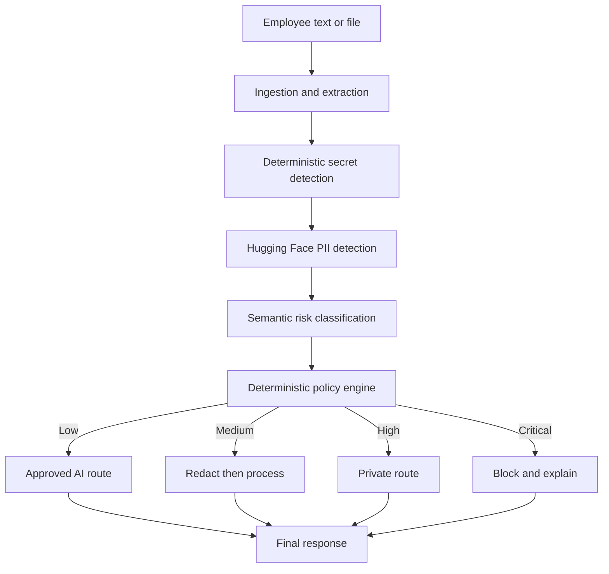

# Sitr AI Gate - Project Overview and Complete Handover

## 1. Handover instructions

You are taking over development of **Sitr AI Gate** for the **Qai x Hugging Face Hackathon O1** in Qatar.

Before editing anything, read these files completely:

1. `PROJECT_OVERVIEW.md`
2. `CLAUDE.md`
3. `INSTRUCTIONS.md`
4. `README.md`
5. `src/contracts.py`

Treat this document as the complete project handover and execution plan. If another document conflicts with it, preserve the security requirements and frozen integration contracts, then flag the conflict before making a major architectural change.

## 2. Project summary

Sitr is an Arabic-English AI security gateway that protects organizations from uncontrolled or inappropriate use of cloud-based AI systems.

Employees may paste or upload CVs, contracts, employee records, financial documents, source code, credentials, and internal business information into AI tools without understanding where the data will be processed or whether the organization permits it.

Sitr intercepts content before inference, identifies sensitive information, assigns a risk level, explains the risk, and chooses the correct route:

| Risk | Action | Result |
|---|---|---|
| Low | Allow | Send to an approved AI route |
| Medium | Redact | Remove sensitive values before processing |
| High | Private | Send only to a controlled private-processing route |
| Critical | Block | Stop processing and explain the threat |

### One-line pitch

> Sitr lets employees use AI without accidentally sending confidential organizational data to the wrong model or environment.

### Pitch opening

> Employees are already using AI at work. The danger is not always malicious behavior; it is an ordinary employee copying the wrong information into the wrong model.

### Pitch closing

> Sitr does not stop Qatar's workforce from using AI. It gives organizations control over what leaves, what is sanitized, what stays private, and what must never be processed.

## 3. Hackathon requirements

The project must:

- Solve a real problem in Qatar or the wider Middle East.
- Run genuinely on Hugging Face infrastructure.
- Work end to end.
- Use the shared $100 compute budget efficiently.
- Be demonstrated clearly and compellingly.
- Be submitted by **Saturday, November 7, 2026, at 2:00 PM Qatar time**.

The team should use **12:30 PM Qatar time** as the internal deadline and preserve the remaining 90 minutes for deployment or submission failures.

## 4. Required demonstration scenarios

The deployed application must demonstrate all four policy decisions:

1. **Allow:** A safe public marketing prompt is approved.
2. **Redact:** A synthetic CV containing a name, email, and telephone number is sanitized.
3. **Private:** A synthetic Arabic-English employment contract containing salary and employee information is routed privately.
4. **Block:** Source code containing a synthetic API key is blocked immediately.

Every identity, number, document, organization, and credential used in the public demo must be fictional.

## 5. Locked technology stack

- Python 3.11
- Gradio
- Hugging Face Spaces
- Hugging Face Transformers and Hub
- Pydantic v2
- PyMuPDF
- `OpenMed/privacy-filter-multilingual-v2` for multilingual PII detection
- `Horizon-Labs/multilingual-zeroshot-small` for semantic risk classification
- `Qwen/Qwen2.5-1.5B-Instruct` for safe rewriting and permitted demonstration responses
- Pytest
- Ruff
- GitHub Actions

Do not replace a locked component unless testing proves that it prevents the complete demonstration from working. Document the failure and proposed replacement before changing the architecture.

## 6. Architecture



The implementation order is:

1. Input validation
2. Text or file extraction
3. Deterministic detection
4. Contextual model detection
5. Finding consolidation
6. Semantic risk classification
7. Deterministic policy decision
8. Redaction when required
9. Safe routing
10. Privacy-safe audit metadata
11. User-facing explanation
12. Temporary-file cleanup

Deterministic security rules override model predictions. Critical findings must never reach a generative model.

## 7. Frozen integration contracts

`src/contracts.py` is the source of truth. Do not change it without agreement from all four team members.

The single public integration function is:

```python
def inspect_and_process(
    text: str | None = None,
    file_path: str | None = None,
    user_intent: str = "summarize",
) -> dict:
    ...
```

All UI and integration code must use this function. Do not duplicate security logic inside `app.py`.

## 8. Four parallel development lanes

### Lane 1 - Ingestion and deterministic security

Branch: `feature/ingestion`

Owned files:

- `src/ingestion.py`
- `src/deterministic.py`
- `examples/`
- `tests/test_ingestion.py`

Responsibilities:

- Text, PDF, image, and source-code ingestion
- Arabic-English text preservation
- Page mapping
- Structured PII detection
- Secret and credential detection
- Exact source offsets
- Four polished synthetic demonstration files

### Lane 2 - Hugging Face intelligence

Branch: `feature/hf-intelligence`

Owned files:

- `src/hf_detection.py`
- `src/risk_classifier.py`
- `data/synthetic_examples.json`
- `tests/test_detection.py`

Responsibilities:

- Multilingual contextual PII detection
- Semantic risk classification
- Model caching
- CPU-compatible execution
- Safe deterministic fallbacks
- Arabic, English, and mixed-language synthetic examples
- Honest measured evaluation

### Lane 3 - Policy and routing

Branch: `feature/policy-routing`

Owned files:

- `src/policy_engine.py`
- `src/redactor.py`
- `src/router.py`
- `src/audit.py`
- `src/orchestrator.py`
- `tests/test_policy.py`

Responsibilities:

- Allow, redact, private, and block decisions
- Stable placeholders
- Overlap-safe redaction
- External, sanitized, private, and blocked routes
- Privacy-safe audit records
- Public orchestration function

### Lane 4 - Product and deployment

Branch: `feature/product`

Owned files:

- `app.py`
- `requirements.txt`
- `README.md`
- `assets/`
- `tests/test_end_to_end.py`

Responsibilities:

- Gradio interface
- Security dashboard
- Integration
- Hugging Face Spaces deployment
- End-to-end testing
- Backup demonstration
- Pitch and submission

## 9. Universal security requirements

- Use synthetic data only.
- Never commit a working credential, token, password, private key, ID, or bank account.
- Never log raw prompts, uploaded documents, detected values, or replacement mappings.
- Never silently modify user input.
- Never send critical content to inference.
- Never send the original high-risk content to an external route.
- Redaction must visibly show what categories changed.
- Temporary files must be removed in success and failure paths.
- The public Space must warn users not to upload real confidential information.
- Do not claim guaranteed legal compliance.
- Do not claim that all cloud computing or cloud AI is inherently unsafe.
- State clearly when the private route is a demonstration or deployment pattern rather than a physically isolated production environment.
- Fail closed for critical findings.

## 10. Git and collaboration rules

- Never commit directly to `main`.
- Work only in the active lane's owned files.
- Use small, focused commits.
- Do not force-push.
- Do not rewrite unrelated working code.
- Run Ruff and Pytest before requesting a merge.
- All changes reach `main` through a pull request.
- Pull requests require passing CI and one teammate review.
- Changes to frozen contracts require approval from all four members.
- Merge order: ingestion, intelligence, policy, then product.
- Run the full test suite after every merge.

At the end of every task, report:

```text
Phase:
Lane:
Branch:
Files changed:
Behavior delivered:
Tests run:
Known limitations:
Security considerations:
Contract assumptions:
Recommended next integration step:
```

# Complete implementation phases

## Phase 1 - Audit, setup, and contract lock

### Goal

Verify the repository, dependencies, contracts, CI, and security baseline before feature implementation begins.

### Tasks

1. Read every project instruction file.
2. Inspect the repository and Git status.
3. Search for accidentally committed secrets or personal information.
4. Review `src/contracts.py`.
5. Check Python 3.11 compatibility.
6. Review `requirements.txt` for Hugging Face Spaces compatibility.
7. Inspect GitHub Actions.
8. Run:

```bash
python -m compileall -q src tests
ruff check .
pytest
```

9. Fix only setup, dependency, validation, or CI issues.
10. Create missing empty modules required by the documented architecture.
11. Add minimal import tests.
12. Freeze the shared contracts.

### Acceptance gate

- Clean installation succeeds.
- Every module imports.
- Ruff passes.
- Pytest passes.
- CI is valid.
- Contracts are frozen and documented.
- No sensitive data exists in the repository.

### Claude prompt

```text
Execute Phase 1 from PROJECT_OVERVIEW.md. Read all required files before editing. Audit the repository, dependencies, contracts, CI, and sensitive-data exposure. Run compilation, Ruff, and Pytest. Fix only setup and validation issues, create missing module shells, freeze the contracts, commit the phase, and return the required completion report.
```

## Phase 2 - Mock-first end-to-end pipeline

### Goal

Build the smallest complete application using mocks before connecting expensive or remote models.

### Tasks

1. Implement all module interfaces.
2. Implement `inspect_and_process`.
3. Add mock model adapters.
4. Create four built-in synthetic text scenarios.
5. Create a basic Gradio interface.
6. Make all four policy routes work.
7. Prove blocked content never reaches inference.
8. Add unit and integration tests.
9. Keep model integrations replaceable.

### Acceptance gate

- All four decisions work through the orchestrator.
- All four decisions work through the UI.
- Critical content never reaches inference.
- Redaction works with repeated entities.
- The app runs without network access.
- Ruff and Pytest pass.

### Claude prompt

```text
Execute Phase 2 from PROJECT_OVERVIEW.md. Build the mock-first end-to-end pipeline without changing frozen contracts. Implement the public orchestrator, all four policy outcomes, basic Gradio UI, built-in synthetic scenarios, and tests proving critical input never reaches inference. Keep model-dependent components mockable. Commit the phase and return the required completion report.
```

## Phase 3 - Ingestion and deterministic security

### Goal

Extract normalized text from supported inputs and reliably identify structured sensitive information and credentials.

### Tasks

#### Ingestion

- Plain text
- Source code
- Digital PDFs through PyMuPDF
- Page-level mapping
- Filename and input-type detection
- Arabic-English preservation
- Language detection
- Empty and corrupted-file handling
- File-size and page-count limits
- Temporary-file cleanup
- Optional OCR behind a feature flag

#### Deterministic detection

Detect:

- Email addresses
- Qatar-style telephone numbers
- Synthetic Qatar ID patterns
- Passport-like identifiers
- IBANs
- Account-number-like values
- Salaries in Arabic and English
- API keys
- Bearer tokens
- JWTs
- Password assignments
- Database connection strings
- Private-key blocks
- Cloud credential patterns
- Internal IP addresses and hostnames

Each finding must include exact offsets, confidence, source, severity, and page where available.

#### Synthetic demonstration files

- `examples/synthetic_cv.pdf`
- `examples/synthetic_contract.pdf`
- `examples/vulnerable_code.py`
- `examples/safe_prompt.txt`

### Acceptance gate

- Every demonstration file extracts correctly.
- Offsets select exact substrings.
- The synthetic API key is critical.
- Safe code is not marked critical.
- Arabic text remains readable.
- Corrupted inputs fail safely.
- Ruff and Pytest pass.

### Claude prompt

```text
Execute Phase 3 from PROJECT_OVERVIEW.md on feature/ingestion. Work only in the ingestion lane's files. Implement robust text, code, and digital-PDF extraction plus deterministic PII and secret detection with exact offsets. Create the four synthetic demonstration files and comprehensive tests. Do not change contracts or policy logic. Commit the phase and return the required completion report.
```

## Phase 4 - Hugging Face intelligence

### Goal

Add contextual multilingual PII detection and semantic risk classification while retaining a safe offline fallback.

### Tasks

1. Validate model cards, licenses, memory requirements, labels, and Arabic support.
2. Load models lazily.
3. Cache loaded models.
4. Support CPU inference.
5. Map token offsets to exact text offsets.
6. Convert model labels into Sitr entity types.
7. Apply confidence thresholds.
8. Deduplicate regex and model findings.
9. Resolve overlapping findings.
10. Preserve deterministic critical findings.
11. Add timeout and failure handling.
12. Implement low, medium, high, and critical semantic risk classification.
13. Add a deterministic fallback.
14. Create 200-400 synthetic Arabic, English, and mixed examples.
15. Create a hidden evaluation split.
16. Measure precision, recall, false positives, action accuracy, language performance, and latency.

### Acceptance gate

- Arabic and English PII are detected.
- Mixed text does not crash.
- Deterministic findings remain authoritative.
- Model failures produce safe fallback behavior.
- Model loading is cached.
- Real evaluation metrics exist.
- Ruff and Pytest pass.

### Claude prompt

```text
Execute Phase 4 from PROJECT_OVERVIEW.md on feature/hf-intelligence. Work only in the Hugging Face intelligence lane's files. Validate the locked models, implement lazy cached multilingual PII detection and semantic risk classification, create deterministic fallbacks, generate synthetic evaluation data, measure real results, and add tests. Never weaken deterministic critical findings. Commit the phase and return the required completion report.
```

## Phase 5 - Policy, redaction, routing, and auditing

### Goal

Convert combined findings into deterministic, explainable, privacy-safe security decisions.

### Mandatory overrides

- Active API key -> critical/block
- Password or database credential -> critical/block
- Private encryption key -> critical/block
- Restricted operational information -> critical/block
- Confidential HR or financial document -> high/private
- Ordinary contact PII -> medium/redact
- Public content without findings -> low/allow

### Redaction requirements

- Stable placeholders such as `[PERSON_1]`
- Consistent placeholders for repeated values
- Correct overlap handling
- Backward text replacement
- Preserved punctuation and readability
- In-memory replacement maps only
- No original values in audit logs

### Routing requirements

- Approved external route
- Sanitized external route
- Private route
- Blocked route
- Mockable development adapters
- Honest labeling of private-route simulation

### Audit fields

Audit only:

- Timestamp
- Request ID
- Input type
- Entity counts by type
- Risk level
- Action
- Reason codes
- Latency
- Model versions
- Success or failure

### Acceptance gate

- All four routes work.
- Critical content never reaches inference.
- High-risk original content never reaches an external route.
- Sanitized text contains no detected value.
- Audit data contains no raw sensitive information.
- Failures do not fail open.
- Ruff and Pytest pass.

### Claude prompt

```text
Execute Phase 5 from PROJECT_OVERVIEW.md on feature/policy-routing. Work only in the policy lane's files. Implement deterministic policy overrides, stable overlap-safe redaction, safe routing adapters, privacy-safe auditing, and the complete orchestrator. Add leakage and failure tests proving critical content never reaches inference and high-risk originals never reach an external route. Commit the phase and return the required completion report.
```

## Phase 6 - Product interface and integration

### Goal

Create a professional Gradio product that explains Sitr within five seconds and completes the live demonstration in less than 90 seconds.

### Required interface

#### Header

- Sitr AI Gate
- One-sentence explanation
- Synthetic-data warning

#### Input

- Text or code input
- PDF or image upload
- Built-in example selector
- Intended AI task
- Inspect button

#### Analysis

- Risk score
- Risk badge
- Action badge
- Explanation
- Entity counts
- Highlighted findings
- Reason codes

#### Transformation

- Original text
- Sanitized text
- Replacement categories
- Approval state

#### Routing and result

- Route used
- Reason for route
- Permitted response
- Block explanation and remediation

#### Dashboard

- Requests inspected
- Requests redacted
- Requests routed privately
- Requests blocked
- Detected entity categories

### Design principles

- Professional enterprise cybersecurity appearance
- Arabic-English support
- RTL Arabic rendering
- Strong accessible risk colors
- Minimal jargon
- Clear loading and error states
- No sensitive values in frontend logs
- Expandable technical details for judges
- Visible Hugging Face model information

### Acceptance gate

- A first-time user understands the product immediately.
- Every built-in scenario works without manual editing.
- Arabic renders correctly.
- Risk and action are unmistakable.
- Errors remain safe and understandable.
- The full demo takes 75-90 seconds.
- End-to-end tests pass.
- Ruff passes.

### Claude prompt

```text
Execute Phase 6 from PROJECT_OVERVIEW.md on feature/product. Build a polished, accessible Gradio interface exclusively around inspect_and_process. Add the four built-in scenarios, analysis, redaction comparison, routing explanation, dashboard, Arabic RTL support, failure states, model details, README documentation, and end-to-end tests. Do not duplicate security logic in app.py. Commit the phase and return the required completion report.
```

## Phase 7 - Hugging Face Spaces deployment

### Goal

Deploy a stable, reproducible, resource-efficient public demonstration.

### Tasks

1. Remove unnecessary dependencies.
2. Pin versions where reproducibility requires it.
3. Confirm `app.py` as the Space entry point.
4. Add required Space metadata.
5. Configure secrets through Space settings only.
6. Ensure deterministic fallback without a token.
7. Configure model caching.
8. Apply file and timeout limits.
9. Prevent persistent upload storage.
10. Display the synthetic-data warning.
11. Deploy to Hugging Face Spaces.
12. Test from clean and incognito browsers.
13. Test from another device.
14. Run all four scenarios repeatedly.
15. Measure cold and warm latency.
16. Test model failures.
17. Verify privacy-safe logs.
18. Capture backup screenshots and video.

### Acceptance gate

- The Space loads publicly.
- All four scenarios work.
- Cold start is handled.
- No real secrets exist in configuration.
- Model failure degrades safely.
- Another device can use the demo.
- Backup media exists.
- CI passes.

### Claude prompt

```text
Execute Phase 7 from PROJECT_OVERVIEW.md. Prepare and deploy the final Hugging Face Space without adding new features. Optimize dependencies, caching, limits, fallback behavior, secret handling, and upload cleanup. Test all four scenarios from clean sessions and another device, measure latency, verify logs, and prepare backup media. Stop only when owner authentication or deployment authorization is required. Commit deployment fixes and return the required completion report.
```

## Phase 8 - Adversarial security review

### Goal

Find and fix verified security, privacy, reliability, and demo-critical weaknesses.

### Test categories

#### Secret bypass

- Spaces inside keys
- Newlines inside keys
- Case variations
- Arabic numerals
- Unicode confusables
- Base64-like credentials
- Secrets in JSON
- Secrets in comments

#### PII bypass

- Arabic names
- English names
- Mixed-language records
- Repeated identifiers
- Punctuation-adjacent values
- Table-extracted values
- PDF-extracted values

#### Redaction

- Overlapping entities
- Repeated values
- Substrings within larger values
- RTL text
- Multiline text
- Original-value leakage

#### Routing

- Critical input never reaches inference
- High-risk originals never reach external inference
- Sanitized prompts contain no detected value
- Model failures never downgrade risk
- Timeouts never fail open

#### Logging

- No raw prompt
- No uploaded document
- No entity value
- No replacement mapping
- No credential
- No sensitive filename

#### File handling

- Oversized files
- Empty files
- Corrupted PDFs
- Unsupported extensions
- Malicious filenames
- Temporary-file cleanup

### Acceptance gate

- No critical content reaches inference.
- No high-risk original reaches an external route.
- No detected value remains after mandatory redaction.
- Logs are privacy-safe.
- Failures do not fail open.
- Regression tests cover verified weaknesses.
- CI passes.
- Known limitations are documented honestly.

### Claude prompt

```text
Execute Phase 8 from PROJECT_OVERVIEW.md. Perform an adversarial security review without adding features. Test secret and PII bypasses, redaction edge cases, routing invariants, logging privacy, malicious files, and UI failure states. Add regression tests for verified weaknesses and apply the smallest safe fixes. Rerun the full suite, review the final diff, commit the fixes, and return the required completion report with residual risks.
```

## Phase 9 - Final pitch and submission

### Goal

Prepare every final judging and submission deliverable.

### Deliverables

1. One-line tagline
2. Submission description
3. 90-second demonstration script
4. Three-minute pitch
5. Qatar-grounded problem statement
6. Architecture explanation
7. Hugging Face usage summary
8. Compute-efficiency summary
9. Real evaluation metrics
10. Security limitations
11. Backup demonstration plan
12. Final checklist

### Required demonstration order

1. Safe marketing prompt -> allow
2. Synthetic CV -> redact
3. Arabic-English contract -> private
4. Synthetic API key -> block
5. Dashboard and measured results

### Pitch rules

- Do not claim all cloud AI is unsafe.
- Do not claim guaranteed legal compliance.
- Do not claim physical private isolation unless it is true.
- State that the public demo uses synthetic data.
- Show genuine Hugging Face usage.
- Use measured results only.
- Explain why Arabic-English detection matters in Qatar.
- Explain the hybrid deterministic and model architecture.
- Explain compute efficiency.

### Acceptance gate

- GitHub CI passes.
- The Hugging Face Space works.
- Repository and Space links are accessible.
- Model and dataset licenses are documented.
- No real sensitive data exists.
- All four scenarios work.
- Backup media works.
- The pitch fits the time limit.
- Submission is ready before 12:30 PM Qatar time.

### Claude prompt

```text
Execute Phase 9 from PROJECT_OVERVIEW.md. Do not modify production code unless a demo-blocking defect exists. Prepare the tagline, submission description, 90-second demo, three-minute pitch, problem statement, architecture and Hugging Face summaries, compute explanation, measured results, limitations, backup plan, and final submission checklist. Verify all links, CI, four scenarios, licenses, privacy, and timing.
```

## 11. Compute budget

| Category | Maximum |
|---|---:|
| Model experiments | $15 |
| Optional small-model fine-tuning | $20 |
| Integration inference | $20 |
| Space hosting | $20 |
| Demo and emergency reserve | $25 |

Rules:

- Run regex and deterministic logic before model inference.
- Cache models and repeated examples.
- Prefer small or quantized models.
- Do not fine-tune until the full application works.
- Announce any experiment expected to cost more than $5.
- Preserve the $25 reserve.

## 12. Final global definition of done

Sitr is complete only when:

- All four scenarios work on the deployed Hugging Face Space.
- Arabic and English are demonstrated.
- Critical secrets are deterministically blocked.
- High-risk original content never reaches an external route.
- PII redaction visibly preserves user intent.
- Audit logs contain no sensitive values.
- Failure paths fail safely.
- All tests and CI pass.
- No real sensitive information exists anywhere.
- Hugging Face model usage is clearly documented and visible.
- Real evaluation results are shown.
- The live demo finishes in under 90 seconds.
- Backup screenshots or video exist.
- The pitch clearly addresses all five judging criteria.

## 13. Autonomous master prompt

Use the following prompt when Claude should complete every phase autonomously:

```text
You are responsible for completing Sitr AI Gate for the Qai x Hugging Face Hackathon.

Read PROJECT_OVERVIEW.md, CLAUDE.md, INSTRUCTIONS.md, README.md, and src/contracts.py completely before editing.

Execute Phases 1 through 9 in PROJECT_OVERVIEW.md. Work incrementally, preserve the frozen contracts, respect file ownership, use separate branches or worktrees where appropriate, add tests for every behavior, run Ruff and Pytest after meaningful changes, review every diff, and commit each completed phase separately.

Do not pause between phases unless:

- A frozen contract must change
- Authentication or owner authorization is required
- A model license prevents use
- A destructive action is necessary
- Tests reveal an architectural conflict
- A security invariant cannot be satisfied

Prioritize a reliable end-to-end demonstration over optional features.

Never use real sensitive data. Never expose credentials. Never allow critical content to reach inference. Never send high-risk original content to an external route. Never log raw input or detected values. Fail closed when critical security processing fails.

For every phase:

1. Inspect the current repository state.
2. Implement the smallest complete milestone.
3. Add or update tests.
4. Run Ruff and Pytest.
5. Review the diff for security and unrelated changes.
6. Commit the phase with a descriptive message.
7. Record results, limitations, and next steps.
8. Continue to the next phase.

Begin with Phase 1 now and continue until all phases are complete or a genuine blocker requires owner input.
```

