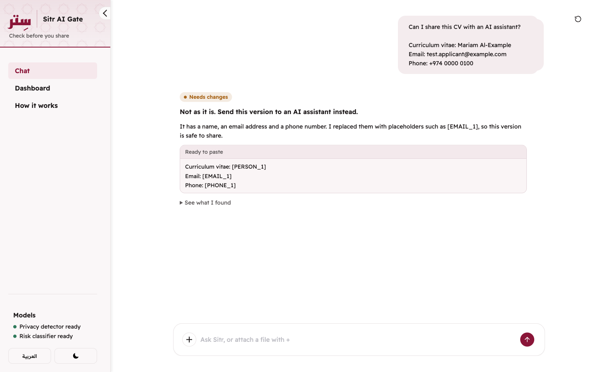
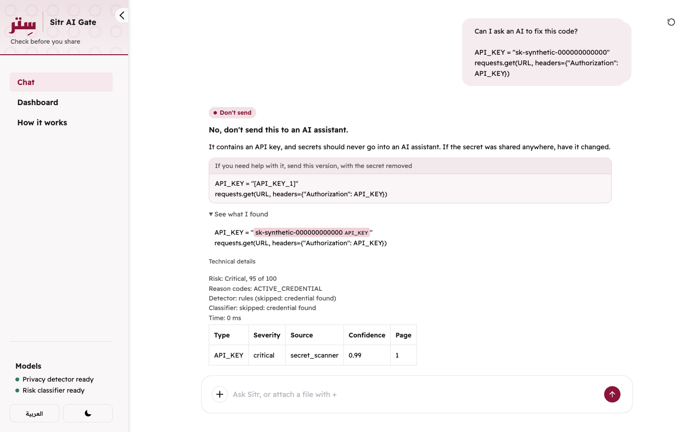
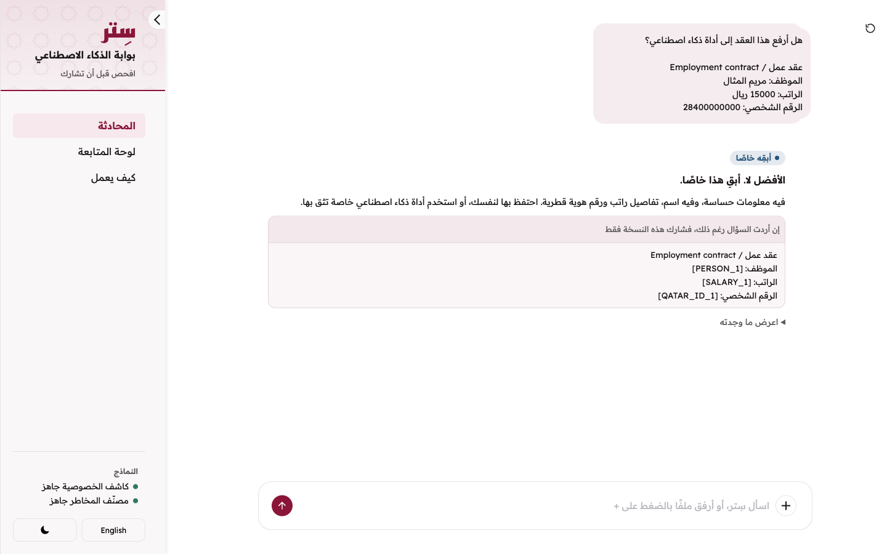
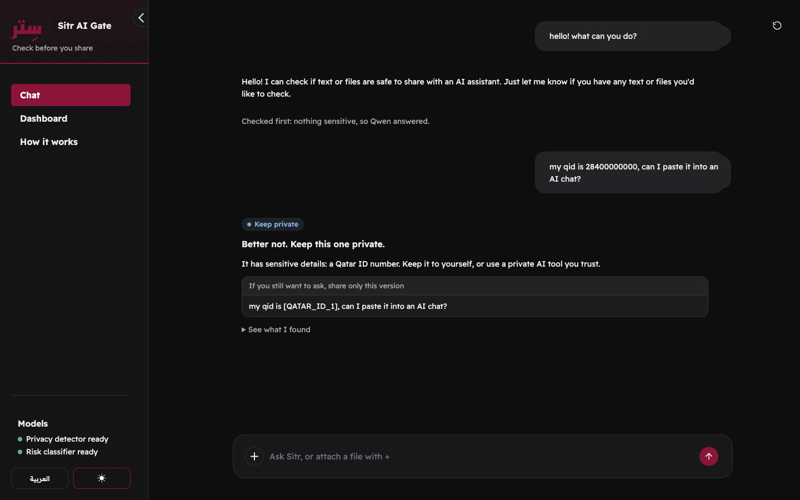
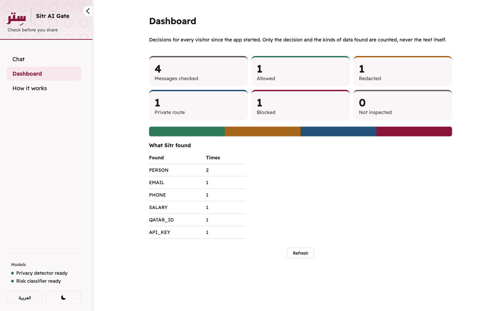
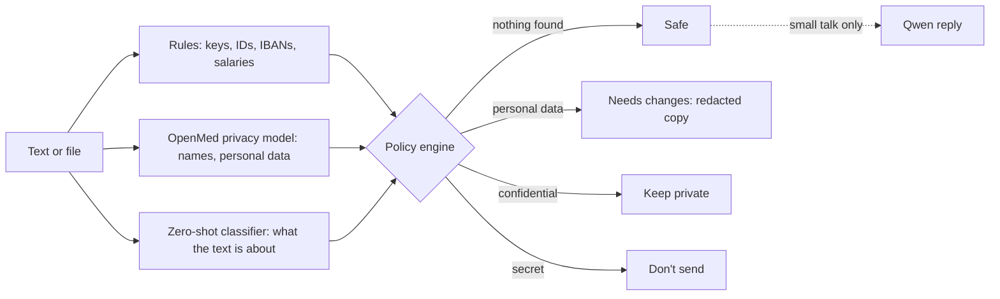

# Sitr AI Gate · سِتر

**Ask Sitr before you ask an AI assistant.** Sitr tells you, in Arabic or English, whether a
message or file is safe to share with an AI assistant, and gives you a version that is.

**[Try it on Hugging Face Spaces](https://huggingface.co/spaces/arwaili/sitr-ai-gate)** ·
[Dataset](https://huggingface.co/datasets/arwaili/sitr-synthetic-dlp) ·
[Submission kit](SUBMISSION.md)

Built for the Qai x Hugging Face Hackathon in Qatar by Abdulaziz, Saad, Mohammed and Rashid.



## What it does

Type or paste text, or attach a PDF, code or text file, and ask "Can I share this?" Sitr
answers with one of four decisions:

| Answer | When | What you get |
|---|---|---|
| **Safe** | Nothing personal, confidential or secret | The text, ready to paste |
| **Needs changes** | Personal data: names, emails, phone numbers | A redacted version (`[EMAIL_1]`), or a redacted PDF for a PDF |
| **Keep private** | Confidential details: salaries, IDs | Advice to keep it private, and a redacted version if you still want to ask |
| **Don't send** | Secrets: API keys, passwords, private keys | A version with the secret removed; the secret never reaches any model |

The findings, risk score and reason codes stay one click away under "See what I found". Small
talk ("hello", "what can you do?") gets a short reply from Qwen, but only after the check finds
nothing sensitive.

| | |
|---|---|
|  |  |
|  |  |

## How it works



1. **Rules** catch structured secrets and identifiers in Arabic and English: API and cloud keys,
   passwords, private keys, JWTs, Qatar IDs, IBANs, card numbers, salaries, emails, phones.
2. **`OpenMed/privacy-filter-multilingual-v2`** finds names and personal data the rules cannot.
3. **`Horizon-Labs/multilingual-zeroshot-small`** reads what the text is about (HR, legal,
   source code) to catch confidential content with no single sensitive token.
4. **The policy engine** decides. Deterministic rules always win over model guesses, and a
   critical secret never reaches any model.
5. **Redacted PDFs** are rebuilt with PyMuPDF and read back: if any found value survives in the
   page text, metadata, outline, links or attachments, the PDF is refused.

## Hugging Face usage

- **Spaces:** the Gradio app runs at https://huggingface.co/spaces/arwaili/sitr-ai-gate.
- **Models:** the two detectors run on CPU inside the app, so no text leaves it to be checked.
  `Qwen/Qwen2.5-1.5B-Instruct` answers allowed small talk through Hugging Face Inference
  Providers (`featherless-ai`), and runs inside the app on the private route, so confidential
  originals never leave it.
- **Jobs and Hub datasets:** [`arwaili/sitr-synthetic-dlp`](https://huggingface.co/datasets/arwaili/sitr-synthetic-dlp)
  is 300 synthetic Arabic, English and mixed examples, generated by `data/generate_dataset.py`
  running as a Hugging Face Job with Qwen, published with dev and test splits.

## Measured results

Held-out `test` split of `arwaili/sitr-synthetic-dlp` (60 examples), through the full pipeline
(rules, both models, policy), from `python data/evaluate.py`:

| Measure | Result |
|---|---|
| Correct action (allow, redact, private, block) | 0.95 (English 1.00, Arabic 0.90, mixed 0.95) |
| Entities (all types), precision / recall | 0.968 / 0.938 |
| Names (OpenMed model), precision / recall | 0.900 / 0.931 |
| Risk model alone, correct level | 0.85 |
| Median latency per request | PII model 238 ms, risk model 159 ms, rules under 1 ms |
| On the Space (cpu-basic, 2 vCPU) | block 1.5-2 s, redact 5-8 s; a Qwen reply adds 4-20 s |

Every wrong action was a public prompt sent to redact because the model read a common Arabic
word as a name. The dataset is template-based, so real documents will score lower.

Before submission the team attacked its own app and fixed three leaks: the uploaded file's name
kept in downloads, values left in PDF metadata and links, and a name missed when the question was
checked together with the content. Each is covered by a regression test, among 306 automated tests.

## Run it locally

```bash
git clone https://github.com/arwaili/sitr-ai-gate.git
cd sitr-ai-gate
python3.11 -m venv .venv
source .venv/bin/activate
pip install -r requirements-dev.txt
python app.py
```

Open http://localhost:7860. The first run downloads about 3.4 GB of models from Hugging Face;
set `SITR_HF_MODELS=0` to run on the rules alone. Qwen replies need a Hugging Face token
(`hf auth login` or `HF_TOKEN`); without one, small talk gets Sitr's normal answer.

All examples are synthetic. Do not upload real confidential data to the public demo. Sitr is a
security decision-support prototype, not a guarantee of legal compliance; the private route is
a demonstration, not an isolated environment. Sitr never logs the text it checks, the values it
finds, or the replacements it makes.

**Built with:** Python 3.11, Gradio 6, Transformers, Hugging Face Hub and Inference Providers,
Pydantic v2, PyMuPDF, Pytest and Ruff in GitHub Actions.

---

## For the team

### Joining

1. Accept the collaborator invite at https://github.com/arwaili/sitr-ai-gate/invitations, clone
   the repository and set up Python 3.11 as above.
2. Check that everything passes:
   ```bash
   python -m compileall -q src tests
   ruff check .
   pytest
   ```
3. Open the folder in Claude Code. It reads `CLAUDE.md` automatically. Tell it your name and ask
   it what to work on.

### Where things are

| File | What it is |
|---|---|
| `TASKS.md` | **Live task board:** owners, status, blockers, and log. Start here. |
| `SUBMISSION.md` | Submission description, 90-second demo, 3-minute pitch, video plan |
| `CLAUDE.md` | Rules every coding agent follows, including the checks before any push |
| `PROJECT_OVERVIEW.md` | The agreed plan: architecture, phases 1 to 9, acceptance gates |
| `CONTRACT_NOTES.md` | How the frozen contracts are used: function signatures, routes, error behavior |
| `INSTRUCTIONS.md` | Lanes, file ownership, and integration rules |
| `src/contracts.py` | Frozen shared data models |
| `space/` | Hugging Face Space package: Space README with metadata, CPU-only requirements, deploy script |
| `ui_text.py` | Every word the interface shows, in English and Arabic (the app shows one at a time) |
| `examples/` | Synthetic demo files (CV and contract PDFs, vulnerable code, safe prompt); `make_examples.py` rebuilds the PDFs |
| `docs/images/` | Screenshots used here, on the Space page, and in the submission |

### Deploying the Space

Hugging Face requires a PRO subscription (or an organization with a plan) to host Gradio Spaces,
even on free CPU Basic hardware.

1. `python space/deploy_space.py --public` updates the Space `arwaili/sitr-ai-gate` (add
   `--repo <owner>/sitr-ai-gate` for another account). It uploads `app.py`, `ui_text.py`, `src/`,
   `examples/`, the screenshots and the files in `space/`.
2. In the Space settings, add a secret named `HF_TOKEN` so Qwen can be called.
3. The first start downloads about 6.5 GB of models. Wait until the bottom of the sidebar shows
   `Privacy detector ready` before the demo; requests that arrive earlier are blocked on purpose.

### GitHub workflow

- `main` is always deployable. Nobody pushes to it directly.
- Work happens on `feature/ingestion`, `feature/hf-intelligence`, `feature/policy-routing`,
  `feature/product`, or `task/<short-name>`.
- Every change reaches `main` through a pull request with passing CI and one teammate's review.
- Nothing is pushed until the checks pass and the diff has been reviewed (see `CLAUDE.md`).
- Shared contract changes require approval from all four team members.
